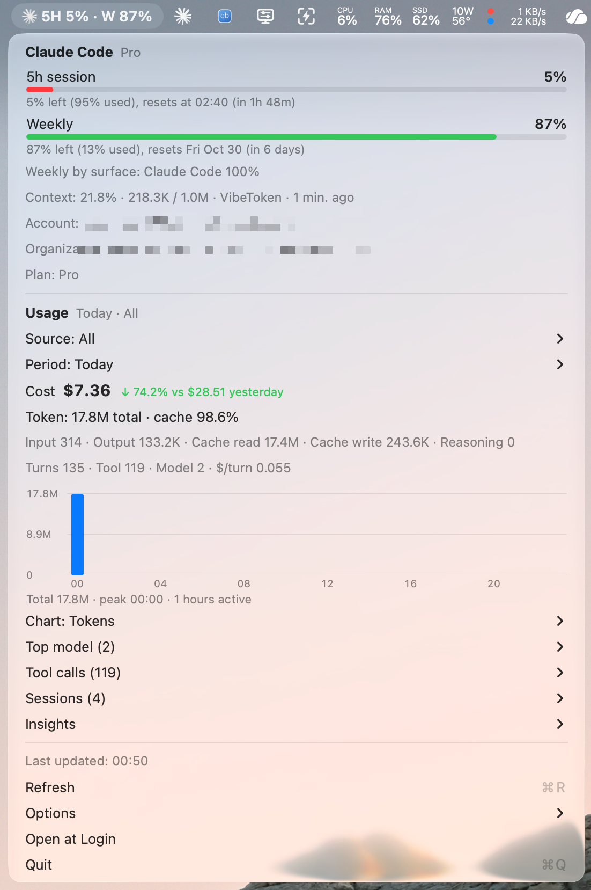

# AIQuota

App menubar macOS siêu nhẹ để xem **quota của Claude Code và Codex**, kèm thống kê token và chi phí giống [TokenWatch](https://github.com/alvin0/token-watch). Không cần đăng nhập thêm: app đọc thông tin đăng nhập sẵn có trên máy.

<p align="center"></p>

```
✳ 5H 5% · W 87%        ← % quota còn lại: phiên 5 giờ · tuần
```

- Swift + AppKit thuần, không thư viện ngoài, 3 file mã nguồn.
- Không icon trên Dock, không cửa sổ, chỉ có một `NSMenu`. Giao diện sáng/tối tự theo theme của máy.
- Nhẹ: khoảng 50 MB RAM, CPU 0% khi rảnh. Một Timer chạy mỗi 5 phút và gọi song song cho các provider.
- Provider nào chưa đăng nhập hoặc chưa sử dụng thì tự ẩn.

## Cài đặt

**Tải bản build sẵn:** vào [Releases](../../releases), tải `AIQuota.zip`, giải nén rồi kéo `AIQuota.app` vào `~/Applications` hoặc `/Applications`.
App được ký ad-hoc, chưa notarize. Vì vậy lần đầu mở, bạn chuột phải vào app → **Open** (hoặc chạy `xattr -dr com.apple.quarantine AIQuota.app`).

**Tự build** (cần Xcode Command Line Tools, macOS 13 trở lên):

```bash
./build.sh             # build, cài vào ~/Applications rồi mở app
./build.sh --no-open   # chỉ build và cài
./build.sh --release   # build universal (Apple Silicon + Intel) -> build/AIQuota.zip
```

## Tính năng

**Quota (Claude Code / Codex)**
- Phiên 5h và tuần: % còn lại kèm % đã dùng, giờ reset, thời gian còn lại.
- Quota tuần theo model hoặc tính năng (Opus, Sonnet, Code Review…) nếu API trả về. Thêm tỉ lệ tuần theo nơi dùng và extra usage.
- Context của phiên gần nhất (ví dụ `21.8% · 218.3K / 1.0M · tên dự án`).
- Tài khoản, tổ chức, gói (Pro/Max, Plus/Pro/Team…).

**Thống kê sử dụng (giống TokenWatch)**
- Lọc theo nguồn (Tất cả / Codex / Claude) và khoảng thời gian (Hôm nay, 7 ngày, 7 tuần, 6 tháng, 2 năm).
- Chi phí so với kỳ trước. Token theo loại: input, output, cache đọc, cache ghi, reasoning. Số lượt, tool, model, chi phí mỗi lượt.
- Biểu đồ theo tokens, chi phí hoặc lượt. Có thêm top model, tool calls, các phiên và insights.

**Tuỳ chọn**
- Tiếng Việt / English.
- Hiện chi phí hôm nay trên menubar.
- Thông báo khi quota ≥ 80% / 95%.
- Cảnh báo chi phí theo ngày/tuần/tháng (báo ở mức 80/95/100%).
- Giá model tuỳ chỉnh, quét lại toàn bộ log.
- Làm mới (⌘R), Mở lúc đăng nhập, Thoát (⌘Q).

## Dữ liệu lấy từ đâu

| | Quota | Tài khoản |
|---|---|---|
| Claude Code | `GET api.anthropic.com/api/oauth/usage`, dùng token đọc từ Keychain `Claude Code-credentials` (dự phòng: `~/.claude/.credentials.json`) | `oauthAccount` trong `~/.claude.json` |
| Codex | Event `token_count` cuối cùng có `rate_limits` trong `~/.codex/sessions/**/rollout-*.jsonl`. Nếu log đã cũ hơn giờ reset thì gọi `GET chatgpt.com/backend-api/wham/usage` (endpoint lấy từ source [openai/codex](https://github.com/openai/codex)) | Decode JWT `id_token` trong `~/.codex/auth.json` |

Thống kê token và chi phí đọc từ log JSONL của Claude Code và Codex. App chỉ lưu số đếm, không lưu nội dung, và cache tăng dần trong `~/Library/Caches/AIQuota`. Chi phí tính theo bảng giá của TokenWatch. Có thể ghi đè giá trong `~/Library/Application Support/AIQuota/pricing.json` (đơn vị USD / 1 triệu token).

## Quyền riêng tư & an toàn

- App chỉ đọc. Không bao giờ refresh token, không ghi vào Keychain, `~/.claude*` hay `~/.codex/`. Refresh sẽ xoay vòng token và làm CLI bị đăng xuất.
- Token chỉ được gửi tới `api.anthropic.com` và `chatgpt.com`. App không log token và không có analytics.
- Token hết hạn: provider đó hiện `—` kèm dòng "Mở … để đăng nhập lại".
- Lỗi mạng: giữ số cũ và ghi "(dữ liệu cũ)". App không gọi API quá 1 lần mỗi 30 giây.

## Gỡ cài đặt

1. Bỏ chọn **Mở lúc đăng nhập** trong menu (hoặc vào System Settings → General → Login Items).
2. Bấm **Thoát** (⌘Q).
3. Xoá app và dữ liệu:

```bash
rm -rf ~/Applications/AIQuota.app ~/Library/Caches/AIQuota "$HOME/Library/Application Support/AIQuota"
defaults delete com.vibetoken.AIQuota
```

## Ghi công

- Ý tưởng, bảng giá model và icon Claude/Codex lấy từ [TokenWatch](https://github.com/alvin0/token-watch) của alvin0 (MIT).
- Tác giả: **Bá Vương**. Giấy phép [MIT](LICENSE).
